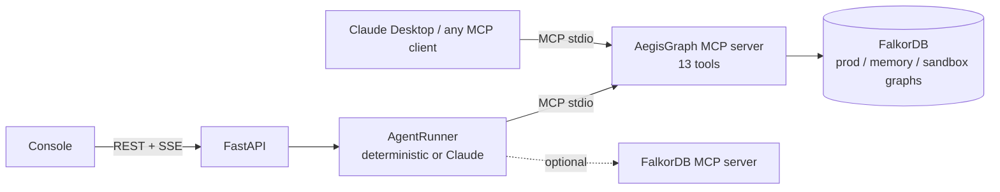
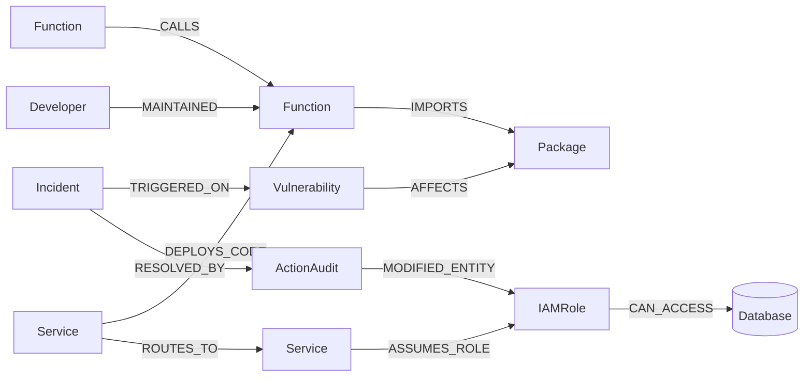

# AegisGraph

**An MCP-native incident agent that uses a FalkorDB graph to find what a vulnerability really exposes, prove a fix is safe in a sandbox graph, apply it surgically and explain every step.**

| | |
|---|---|
| Hackathon | [Graph Hacks: Context for AI Agents](https://www.wemakedevs.org/hackathons/falkordb) (WeMakeDevs x FalkorDB) |
| Track | **Track 01: Agents That Act on Connected Data** |
| Demo video | [▶ Watch 1080p Walkthrough (aegisgraph_demo.mp4)](https://github.com/Hellinferno/graph-hack-/blob/main/aegisgraph_demo.mp4) |
| Live deployment | Local setup below (see [Quick start](#quick-start)) |
| Blog post | [Read Hackathon Technical Deep-Dive (docs/BLOG_POST.md)](docs/BLOG_POST.md) |

## 🎥 Demo Walkthrough Video

https://github.com/Hellinferno/graph-hack-/blob/main/aegisgraph_demo.mp4

<div align="center">
  <video src="https://github.com/Hellinferno/graph-hack-/raw/main/aegisgraph_demo.mp4" controls width="100%" style="border-radius: 8px; max-width: 900px; box-shadow: 0 4px 20px rgba(0,0,0,0.5);">
    Your browser does not support the video tag.
  </video>
  <p>🎬 <b><a href="https://github.com/Hellinferno/graph-hack-/blob/main/aegisgraph_demo.mp4">Click here to play the 1080p walkthrough directly in GitHub's video player</a></b></p>
</div>

## What it does

A security alert arrives as raw text: *"WAF observed 1,240 bearer tokens with forged kid headers accepted by auth-token-service; signature verification bypass suspected in jwt-crypto-core"*. AegisGraph then:

1. **Anchors** the alert in the graph with hybrid vector + full-text search and finds `CVE-2026-8841` in `jwt-crypto-core`.
2. **Traces the blast radius** with one multi-hop Cypher traversal: CVE → package → functions → services → service mesh → IAM roles → PII databases. It finds **6 active attack paths into 3 PII databases**.
3. **Finds the chokepoint** with FalkorDB's native algorithms. `legacy-billing-bridge` sits on all 6 paths and has the highest betweenness of any service (6.0). The runner-up, `payment-orchestrator` (5.83), is critical-tier, so it is protected.
4. **Proves the fix in a counterfactual sandbox.** It clones production with `GRAPH.COPY`, severs the bridge, then checks with path queries and `algo.WCC` that exposure drops to 0 while every critical customer flow stays connected.
5. **Acts and verifies.** It isolates the bridge and quarantines its IAM role with reversible status flags, and routes a pull request to the on-call owner found through the graph (`@aarav-sec`). It writes an `ActionAudit` node holding the scores, the proof paths and the exact Cypher, then re-traces to confirm **exposure is 0**.

Every step is an MCP tool call that the agent selects, and every result carries the Cypher that produced it. The whole loop runs in under a second without an LLM, or with Claude choosing the tools itself.

| Demo incident `INC-2026-091` | Result |
|---|---|
| Exposure paths to PII data | 6 → 0 |
| PII databases exposed | 3 (`customer-kyc-vault-db`, `global-settlement-ledger`, `reporting-warehouse`) |
| Chosen chokepoint | `legacy-billing-bridge` + role `LegacyBillingBridgeAdmin` |
| Critical flows after the change | 4 of 4 intact (proved in the sandbox first) |
| MCP tool calls (deterministic mode) | 9 |
| Rollback | One call restores all 7 mutations and reopens the incident |

## Why this needs a graph

The question *"what customer data can an attacker reach through this CVE, and what can we cut without taking checkout down?"* spans three systems that are normally kept apart:

- **Code:** which functions import the vulnerable package, and who calls them.
- **Runtime:** which services deploy that code and where their traffic goes.
- **Identity:** which IAM roles those services assume and which databases the roles can read.

The answer is a 5 to 8 hop path across all three. A vector store can only return text that sounds like JWT bugs. SQL needs a recursive join over a schema that changes with every new relationship type. In FalkorDB it is a single traversal, and centrality, shortest paths and connected components are built-in procedures the agent calls as tools.

## How FalkorDB powers AegisGraph (Rule 3)

FalkorDB is the only datastore, and every decision is a graph query:

| Agent capability | FalkorDB feature |
|---|---|
| Map an alert to graph nodes | HNSW vector index `db.idx.vector.queryNodes` + full-text index `db.idx.fulltext.queryNodes` |
| Blast radius | Variable-length traversal `ROUTES_TO*0..3` with `ALL(...)` edge-status predicates |
| Chokepoint and criticality | `algo.betweenness`, `algo.pageRank`, `algo.HarmonicCentrality` |
| Proof path and neighbourhood | `algo.SPpaths`, `algo.BFS` |
| Community structure | `algo.labelPropagation`, `algo.WCC` |
| Counterfactual safety check | `GRAPH.COPY` into a sandbox graph, edge deletion, path checks, `algo.WCC` |
| Action and audit trail | Graph mutations plus `ActionAudit` nodes linked with `RESOLVED_BY` and `MODIFIED_ENTITY` |
| Cross-session memory | A separate memory graph of episodes, tool calls, simulations and playbooks |
| Safe ad-hoc exploration | `GRAPH.RO_QUERY` (FalkorDB rejects writes) |

Remove FalkorDB and nothing works. There is no fallback store, `/api/health` returns 503, and every tool fails.

## Architecture



Every tool the agent uses is discovered and called over MCP (`tools/list` + `tools/call`), so the same tools work from the console, the CLI, Claude Desktop or any other MCP client. The orchestrator itself only loads the incident record and writes its episode log to the memory graph directly. Details are in [docs/ARCHITECTURE.md](docs/ARCHITECTURE.md).

## Graph data model

Three graphs live in one FalkorDB instance:

- `aegis_prod_graph`: the topology, plus incidents and audits.
- `aegis_memory_graph`: the agent's episodic and procedural memory.
- `aegis_sim_<incident>_<id>`: the sandbox clones, one per simulation.



There are 9 node labels and 11 relationship types, with 10 range indexes, 2 HNSW vector indexes (384-dimension cosine) and 1 full-text index. The seeded dataset is synthetic: 49 nodes and 69 relationships. Every property, index and seeded fact is listed in [docs/GRAPH_MODEL.md](docs/GRAPH_MODEL.md).

## Cypher queries and graph algorithms

[docs/CYPHER_QUERIES.md](docs/CYPHER_QUERIES.md) lists every statement the MCP tools execute against the production, sandbox and memory graphs (including the simulate-before-act gate), grouped by tool. It is generated by `scripts/export_cypher.py` from a real run, so it always matches the code. The core exposure query is:

```cypher
MATCH (v:Vulnerability {id: $cve_id})-[:AFFECTS]->(pkg:Package)<-[:IMPORTS]-(f:Function)<-[:DEPLOYS_CODE]-(origin:Service)
WITH DISTINCT origin
MATCH attack = (origin)-[:ROUTES_TO*0..3]->(pivot:Service)-[:ASSUMES_ROLE]->(role:IAMRole)-[acc:CAN_ACCESS]->(db:Database {contains_pii: true})
WHERE ALL(r IN relationships(attack) WHERE coalesce(r.status, 'ACTIVE') = 'ACTIVE')
RETURN origin.name, pivot.name, role.name, db.name, length(attack) AS total_hops,
       [n IN nodes(attack) | coalesce(n.name, n.id)] AS path_nodes
ORDER BY total_hops
```

And the chokepoint ranking:

```cypher
CALL algo.betweenness({nodeLabels: ['Service'], relationshipTypes: ['ROUTES_TO']}) YIELD node, score
RETURN node.name, node.tier, node.rps, score ORDER BY score DESC
```

## MCP tools

| Stage | Tool | What it does |
|---|---|---|
| Anchor | `recall_similar_incidents` | Past mitigated incidents plus playbooks and episodes from memory |
| Anchor | `find_entry_points` | Hybrid vector + full-text anchoring, then a 4-hop expansion to services |
| Blast radius | `trace_blast_radius` | Every active path from vulnerable code to PII data |
| Chokepoint | `rank_service_criticality` | PageRank, betweenness and harmonic centrality |
| Chokepoint | `shortest_attack_path` | `algo.SPpaths` proof path between a service and a database |
| Chokepoint | `expand_neighborhood` | `algo.BFS` reachable services |
| Chokepoint | `detect_service_communities` | Label propagation + WCC |
| Chokepoint | `find_code_owner` | Owner and fix version via `MAINTAINED` |
| Simulate | `simulate_remediation` | `GRAPH.COPY` sandbox: exposure, critical flows, WCC |
| Act | `execute_remediation` | Guarded, reversible mutation + audit + PR draft + playbook |
| Act | `rollback_remediation` | Replays the audit's mutations in reverse |
| Explain | `get_decision_proof` | Audits and a proof subgraph for an incident |
| Explore | `read_graph` | Ad-hoc read-only Cypher |

The guardrails are enforced in the tools, not just in the prompt:

- Critical-tier services are never isolated, and an IAM role also used by a critical service is never quarantined.
- `execute_remediation` refuses unless a passing simulation exists for the same incident, CVE, bridge and role. A simulation only passes if there was exposure to close.
- The incident is marked mitigated only after the live graph is re-checked and shows zero exposure; otherwise the action is reported as `PARTIAL`.
- Every action needs a justification, entities that are already isolated cannot be acted on twice, and every mutation is recorded so it can be undone.
- Execute and rollback are serialised, so concurrent runs never interleave their changes.

## Quick start

### Prerequisites

- Docker Desktop (or any Docker engine)
- Python 3.11+ (developed on 3.12)
- Node.js 20.19+ or 22.12+ (for the console; developed on Node 24)

### 1. Start FalkorDB

```bash
cp .env.example .env          # optional, edit ports/keys here
docker compose up -d          # FalkorDB on :6379, FalkorDB Browser on http://localhost:3000
```

> **Windows:** if this fails with `bind: An attempt was made to access a socket in a way forbidden by its access permissions`, the port sits inside a range Windows reserved for Hyper-V. The reservations can change after a reboot. Check them with `netsh interface ipv4 show excludedportrange protocol=tcp`. Then pick free ports above the dynamic range in `.env`, for example `FALKORDB_PORT=16379` and `FALKORDB_BROWSER_PORT=13000`, and run `docker compose up -d` again. The backend and the console's browser link read the same variables.

### 2. Install and seed

```bash
python -m venv .venv
.venv/Scripts/python -m pip install -r requirements.txt     # macOS/Linux: .venv/bin/python
cd backend
../.venv/Scripts/python -m aegis seed
```

### 3. Run the agent from the terminal

```bash
../.venv/Scripts/python -m aegis tools                                  # tools discovered over MCP
../.venv/Scripts/python -m aegis run INC-2026-091 --mode deterministic  # investigate + remediate
```

Run `python -m aegis seed` again to reset the demo. The memory graph keeps what the agent learned; add `--reset-memory` to wipe it too.

### 4. Run the console

```bash
# terminal 1 (backend/):
../.venv/Scripts/python -m aegis api --port 8000
# terminal 2:
cd frontend && npm install && npm run dev       # http://localhost:5173
```

`scripts/run_backend.ps1` and `scripts/run_backend.sh` start FalkorDB, seed if needed and launch the API in one step. Opening `http://localhost:5173/?mock=1` previews the console with recorded data and no backend.

### LLM mode (optional)

In LLM mode a model receives the 13 MCP tools and the investigation doctrine and chooses the calls itself. Its reasoning streams to the console. The guardrails live in the tools, so they hold whatever the model does. Without a key, `auto` mode runs the deterministic doctrine over the same MCP tools.

**OpenRouter, free models only.** Create a key at <https://openrouter.ai/keys>, put `OPENROUTER_API_KEY=...` in `.env`, and restart the API.

- **Models:** the default is `nvidia/nemotron-3-ultra-550b-a55b:free`, with `google/gemma-4-31b-it:free` and `openrouter/free` as fallbacks. OpenRouter switches to the next one when a model errors or is rate limited. Change them with `AEGIS_OPENROUTER_MODEL` and `AEGIS_OPENROUTER_FALLBACKS`.
- **Free only:** AegisGraph checks OpenRouter's public model list and refuses to call any model that isn't priced at zero.
- **Rate limits:** free models allow 20 requests per minute and 50 per day without purchased credits. A full investigation takes about 7 to 10 requests, and HTTP 429 responses are retried with backoff.

**Anthropic.** Alternatively, put `ANTHROPIC_API_KEY=...` in `.env` to run Claude (`claude-opus-5-5` by default). If both keys are set, `AEGIS_LLM_PROVIDER=openrouter|anthropic` picks one.

Then select **llm** in the console, or run `python -m aegis run INC-2026-091 --mode llm`.

### Use the tools from Claude Desktop or another MCP client

```json
{
  "mcpServers": {
    "aegisgraph": {
      "command": "<repo>/.venv/Scripts/python.exe",
      "args": ["-m", "aegis.mcp_server"],
      "env": { "PYTHONPATH": "<repo>/backend", "FALKORDB_HOST": "localhost", "FALKORDB_PORT": "6379" }
    }
  }
}
```

The official [FalkorDB MCP server](https://docs.falkordb.com/genai-tools/mcpserver) is pinned in `mcp/falkordb-mcpserver`. Install it with `npm install` there, then set `AEGIS_ENABLE_FALKORDB_MCP=true` to attach its generic graph tools to the agent alongside AegisGraph's.

## Tests

```bash
cd backend
../.venv/Scripts/python -m pytest
```

There are 68 tests, all run against a live FalkorDB using isolated `test_aegis_*` graphs. They never call a real LLM. They cover:

- the seed counts and indexes;
- every tool, including the expected demo facts above;
- the full simulate, execute, verify and rollback cycle;
- the guardrails;
- the MCP server over stdio;
- the deterministic agent end to end;
- both LLM loops against scripted models (Anthropic, and OpenRouter through a mocked HTTP transport): parallel tool calls, truncation, refusal, fallback, rate-limit retry, malformed tool arguments and free-only enforcement;
- one regression test for each defect found by the two multi-agent code reviews;
- the REST and SSE API.

## Project layout

```text
aegisgraph/
├── docker-compose.yml        FalkorDB + Browser
├── backend/aegis/            config, graph helpers, embeddings, seed, memory, tools, MCP server/client, agent, API, CLI
├── backend/tests/            pytest suite (live FalkorDB)
├── frontend/                 React + Vite console
├── mcp/falkordb-mcpserver/   pinned official FalkorDB MCP server
├── scripts/                  run_backend.{ps1,sh}, export_cypher.py
└── docs/                     ARCHITECTURE.md, GRAPH_MODEL.md, CYPHER_QUERIES.md, DESIGN.md, DEMO_SCRIPT.md, BLOG_POST.md
```

`scripts/export_cypher.py` regenerates `docs/CYPHER_QUERIES.md` from a real run. `scripts/record_mock_fixture.py` re-records the console's `?mock=1` replay from the live API.

## AI coding assistant disclosure (Rule 11)

AI coding assistants (Claude / Antigravity IDE) were used during development to assist with component scaffolding, typing, test suite generation, and documentation drafting. The core domain architecture, multi-graph topology (production, episodic memory, counterfactual sandbox), security investigation doctrine, Cypher traversals, algorithm integrations (`algo.betweenness`, `algo.pageRank`, `algo.WCC`, `algo.SPpaths`), and MCP tool safety gates were designed, code-reviewed, and verified by our team against a live FalkorDB 6.0.2 instance.
