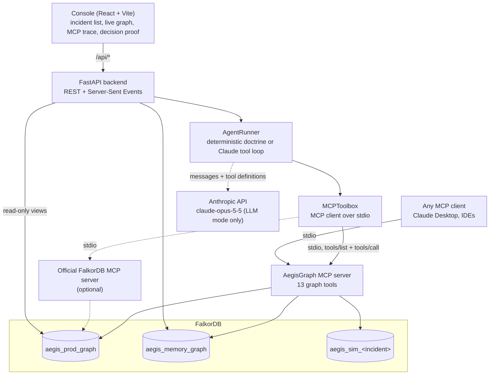

# Architecture

## Components

| Module | Responsibility |
|---|---|
| `backend/aegis/tools.py` | The 13 graph tools. Each is a plain function that runs Cypher and graph algorithms and returns a dict with the result, the exact `cypher` statements executed (with server timings) and `duration_ms`. |
| `backend/aegis/mcp_server.py` | Registers every tool on an MCP server (`mcp` SDK 2.x `MCPServer`) and serves it over stdio. Tool docstrings are the descriptions the model sees. |
| `backend/aegis/mcp_client.py` | `MCPToolbox` spawns the MCP server subprocess (and optionally the official FalkorDB MCP server), discovers tools with `tools/list` and invokes them with `tools/call`. |
| `backend/aegis/agent.py` | `AgentRunner`: the incident loop. It emits a typed event stream and records every run in the memory graph. |
| `backend/aegis/memory.py` | Episodes, tool calls, simulations and playbooks in `aegis_memory_graph`, plus the simulation gate used by `execute_remediation`. |
| `backend/aegis/api.py` | REST endpoints, agent runs as background tasks, and SSE streaming of run events. |
| `backend/aegis/seed.py` | The synthetic dataset and all index definitions. |
| `frontend/` | The console that drives runs and visualises the graph, the trace and the decision proof. |

The agent never imports `tools.py`. Every tool it uses is discovered and called over the Model Context Protocol, in both modes. The orchestrator itself only loads the incident record and writes its episode log to the memory graph directly.

## The incident loop

| Stage | Tools | What the graph decides |
|---|---|---|
| 1. Anchor | `recall_similar_incidents`, `find_entry_points` | Which CVE the raw alert is about (HNSW vector KNN + full-text), which packages, functions and services it reaches, and whether a playbook already exists for it. |
| 2. Blast radius | `trace_blast_radius` | Every active path from the vulnerable code to a PII database: 5 to 8 hops across code, mesh and identity. |
| 3. Chokepoint | `rank_service_criticality`, `shortest_attack_path`, `expand_neighborhood`, `detect_service_communities`, `find_code_owner` | Where the attack paths funnel (`algo.betweenness`), how central each service is (`algo.pageRank`, harmonic centrality), the concrete proof path (`algo.SPpaths`) and who owns the fix. |
| 4. Simulate | `simulate_remediation` | Whether the proposed action is safe: exposure must drop to zero, critical flows must keep a route, and critical services must stay in one `algo.WCC` component in a `GRAPH.COPY` sandbox. |
| 5. Act and verify | `execute_remediation`, `trace_blast_radius` | The surgical mutation, the audit node, the pull request draft and the playbook, then a re-trace proving exposure is zero. |

`get_decision_proof`, `rollback_remediation` and `read_graph` support review, undo and ad-hoc read-only exploration.

### Deterministic mode

`AgentRunner._run_deterministic` follows the stages in order and reads each decision off the tool results:

1. The best anchor match gives the CVE and its package.
2. Candidates are the pivot services of the exposure paths. Each gets a *coverage* score (how many exposure paths pass through it) and its betweenness and PageRank.
3. Critical-tier candidates are ineligible. Eligible candidates are ranked by coverage, then betweenness, then lowest request rate. The IAM role is the one the chosen service assumes on the paths.
4. If no candidate is eligible, the run ends with `NO_ACTION` and the fix is routed to the code owner without isolating anything.
5. If the sandbox says the action is unsafe, the run ends with `NO_ACTION` and the reasons.

On the demo incident this produces 9 MCP calls in well under a second, using no LLM.

### LLM mode

`AgentRunner._run_llm` dispatches to one of two providers, chosen by `AEGIS_LLM_PROVIDER` or by whichever key is set. Both share the tools, the events, the decision and the guardrails.

#### OpenRouter, free models only (`llm_openrouter.py`)

- **API:** plain `httpx` calls to the OpenAI-compatible `POST /api/v1/chat/completions`. MCP tools become function tools, results go back as `role: tool` messages keyed by `tool_call_id`, and each model turn is one request.
- **Fallbacks:** `models` carries the primary model and its fallbacks, which OpenRouter tries in order when a model errors or is rate limited. The model that answered is shown in the narrative.
- **Free only:** before the first request, every configured model is checked against OpenRouter's public `/models` price list, and the run is refused unless all are priced at zero. Set `AEGIS_OPENROUTER_ALLOW_PAID=true` to override.
- **Retries:** HTTP 429, 408 and 5xx responses are retried with backoff that honours `Retry-After`.
- **Reasoning:** sent with `AEGIS_OPENROUTER_REASONING` (default `medium`). `message.reasoning` streams to the console as `thinking`, and `reasoning_details` are echoed back unchanged.
- **Safety stops:** malformed tool arguments are answered with an `INVALID_ARGUMENTS` error result and never executed. `finish_reason: length` never runs the truncated calls. `content_filter` or a refusal ends the run without running tools.

#### Anthropic (`claude-opus-5-5`)

The Anthropic loop gives Claude the MCP tool list (name, description, input schema) and a system prompt describing the same doctrine, then runs a manual tool-use loop. The loop is manual because each step has to stream events to the console.

- **Model:** `claude-opus-5-5` (override with `AEGIS_LLM_MODEL`), with adaptive thinking and `display: "summarized"`, so reasoning summaries stream to the console as `thinking` events. Depth is set with `output_config.effort` (`AEGIS_LLM_EFFORT`, default `high`).
- **Streaming:** `client.beta.messages.stream(...)`, then `get_final_message()`.
- **Prompt caching:** an explicit breakpoint on the static system prompt plus top-level automatic caching for the growing conversation.
- **Refusal fallbacks:** `fallbacks: "default"` with the `server-side-fallback-2026-07-01` beta. A safety-classifier false positive on security content is re-run server-side on the recommended fallback model. When a fallback boundary appears, model-internal blocks before it are dropped before the turn is echoed back, as the API requires.
- **Tool selection:** the model chooses tools itself. `tool_choice` is left on `auto`, because forced tool use is rejected by this model family.
- **Tool results:** returned to the model without the bulky `cypher` and `path` payloads. The UI and the audit still receive them in full.
- **Append-only history:** earlier turns are never edited, which keeps thinking blocks valid.
- **Safety stops:** a `refusal` stop never executes that turn's tools. A `max_tokens` stop never executes a possibly truncated tool call; each one is answered with an error result and the model is asked to continue. A second consecutive truncation ends the run. Runs are capped at `AEGIS_MAX_TOOL_ITERATIONS`.

The orchestrator derives the same `stage`, `graph_highlight` and `decision` events from whichever tools the model calls, so the console behaves identically in both modes.

## Guardrails

| Guardrail | Where | Behaviour |
|---|---|---|
| Never isolate critical services | `simulate_remediation`, `execute_remediation`, deterministic policy | Critical-tier bridges are refused outright. The IAM role must be one the bridge assumes, and a role also assumed by a critical-tier service is never quarantined. |
| Simulate before acting | `execute_remediation` + `memory.latest_passing_simulation` | Execution is refused (status `REFUSED`, not an exception, so the model can recover) unless a passing simulation exists for the same incident, CVE, bridge and role within `AEGIS_SIM_TTL_MINUTES`. A simulation passes only if the CVE had exposure and the change closes all of it. The gate query appears in the tool's Cypher trace. |
| Verify before declaring success | `execute_remediation` | After the mutations, exposure is re-counted on the live graph. Only zero marks the incident `MITIGATED` and records a playbook. Otherwise the status is `PARTIAL`, the incident stays `OPEN`, and the audit can be rolled back. |
| One action per entity, shared edges refcounted | `execute_remediation`, `rollback_remediation` | An already isolated bridge or quarantined role is refused until its audit is rolled back. Every edge and node an action flips records the audit in a `held_by` list; rollback releases that hold and restores the previous status only when no other active action still holds it, so two actions that share a route never reopen it early. Execute and rollback are serialised. |
| Nothing to fix | `execute_remediation` | Returns `NO_ACTION_NEEDED` when the CVE has no active exposure. |
| Explain every action | `execute_remediation` | Requires a justification of at least 20 characters. It is stored on the audit node with the scores, proof paths, mutations and Cypher. |
| Reversible mutations | `execute_remediation`, `rollback_remediation` | Production edges and nodes only get status flags plus `previous_status`. Every mutation is recorded on the audit and can be replayed in reverse. |
| Read-only exploration | `read_graph` | Runs through `GRAPH.RO_QUERY`, so FalkorDB itself rejects any write. At most `limit` rows (maximum 500) are returned, even if the query has its own `LIMIT`, and the query is cancelled after 5 s. |
| No unguarded write path | `mcp_client.py`, `api.py`, `docker-compose.yml` | The optional official FalkorDB MCP server runs in strict read-only mode, and its `query_graph` and `delete_graph` tools are not exposed. State-changing API calls from a browser page on another origin are rejected. FalkorDB and its browser are published on 127.0.0.1 only. |
| Errors the model can read | `tools.ToolError` | Subclasses the MCP SDK's `ToolError`, so the reason reaches the model as an `is_error` result. Unexpected crashes stay generic. |

## Explainability

Every decision can be traced back to graph evidence at three levels:

1. **Per call:** each tool result includes `cypher`, the list of statements executed with parameters, row counts and FalkorDB server time. The console shows them under each tool call, and `docs/CYPHER_QUERIES.md` is generated from them.
2. **Per action:** the `ActionAudit` node stores the justification, betweenness and PageRank of the bridge, the simulation id, the attack paths that justified the action, every mutation and the Cypher proof. It links to the incident and to every entity it modified.
3. **Per incident:** `get_decision_proof` returns the incident, its audits and a proof subgraph (incident, vulnerability, audit, modified entities and the attack paths) for visualisation.

## Memory across sessions

Each run creates an `Episode` in `aegis_memory_graph` and records every MCP call as a `ToolCall` with arguments, a result digest and its duration. Simulations are recorded whether or not they pass. A successful remediation upserts a `Playbook` keyed by the affected package. The next investigation of the same package recalls it during the anchor stage. The memory graph survives reseeding production and is shared by the CLI, the API and both agent modes.

## Run events

The API buffers every event of a run and streams it over SSE at `/api/runs/{id}/events`, replaying history to late subscribers. Each event has `type`, `ts` and `run_id`.

| Event | Key fields |
|---|---|
| `run_started` | `incident_id`, `mode`, `model`, `tools`, `episode_id` |
| `stage` | `stage` (1-5), `name`, `status` (`started`, `completed`, `skipped`) |
| `thinking`, `assistant_text` | `text` (LLM mode) |
| `tool_call` | `call_id`, `name`, `args`, `seq` |
| `tool_result` | `call_id`, `name`, `result`, `duration_ms`, `is_error`, `server` |
| `graph_highlight` | `style` (`attack`, `proof`, `chokepoint`, `safe`, `quarantined`), `nodes`, `edges`, `label` |
| `decision` | `action`, `bridge_service`, `iam_role`, `justification`, `scores`, `sim_passed`, `code_owner`, `candidates` |
| `run_completed` | `outcome`, `summary`, `audit_id`, `duration_ms`, `tool_call_count`, `episode_id` |
| `error` | `message`, `recoverable` |

## Why FalkorDB cannot be removed

Every capability above is a query or algorithm executed by FalkorDB:

- anchoring (vector and full-text indexes);
- exposure (variable-length traversal);
- target selection (betweenness, PageRank, shortest paths);
- safety (`GRAPH.COPY` sandboxes, path checks and WCC);
- action (graph mutations);
- explanation (the audit subgraph);
- memory (the memory graph).

There is no other datastore and no fallback. With FalkorDB stopped, `/api/health` returns HTTP 503, every tool call fails, and the console shows that the graph is unreachable.

## Configuration

| Variable | Default | Purpose |
|---|---|---|
| `FALKORDB_HOST` / `FALKORDB_PORT` | `localhost` / `6379` | FalkorDB connection. Also the host port published by `docker-compose.yml`. |
| `FALKORDB_BROWSER_PORT` | `3000` | Host port of the FalkorDB Browser. The console's "FalkorDB Browser" link follows it (override the full URL with `AEGIS_FALKORDB_BROWSER_URL`). |
| `FALKORDB_USERNAME` / `FALKORDB_PASSWORD` | empty | Credentials, for FalkorDB Cloud. |
| `AEGIS_GRAPH_PREFIX` | `aegis_` | Prefix for the prod, memory and sandbox graphs. |
| `AEGIS_LLM_PROVIDER` | auto | `openrouter` or `anthropic`. When empty, it uses whichever key is set (Anthropic if both are). |
| `OPENROUTER_API_KEY` | empty | Enables LLM mode on OpenRouter free models. |
| `AEGIS_OPENROUTER_MODEL` / `AEGIS_OPENROUTER_FALLBACKS` | `nvidia/nemotron-3-ultra-550b-a55b:free` / `google/gemma-4-31b-it:free,openrouter/free` | Primary OpenRouter model and its fallbacks, tried in order. |
| `AEGIS_OPENROUTER_REASONING` | `medium` | Reasoning effort sent to OpenRouter (`omit` sends none). |
| `AEGIS_OPENROUTER_ALLOW_PAID` | `false` | Allow non-free OpenRouter models. |
| `ANTHROPIC_API_KEY` | empty | Enables LLM mode on Claude. |
| `AEGIS_LLM_MODEL` / `AEGIS_LLM_EFFORT` | `claude-opus-5-5` / `high` | Model and effort for LLM mode. |
| `AEGIS_MAX_TOOL_ITERATIONS` | `25` | Upper bound on model turns per run. |
| `AEGIS_SIM_TTL_MINUTES` | `30` | How long a passing simulation authorises execution. |
| `AEGIS_KEEP_SANDBOX` | `true` | Keep sandboxes for inspection in the console or the FalkorDB Browser: the newest three `aegis_sim_<incident>_<id>` graphs per incident are kept, older ones are deleted, and reseeding drops them all. With `false`, each sandbox is deleted as soon as its simulation ends, even if it fails. |
| `AEGIS_ENABLE_FALKORDB_MCP` | `false` | Also attach the official FalkorDB MCP server. Its tools then appear alongside AegisGraph's. |
| `AEGIS_EMBED_DIM` | `384` | Embedding and vector index dimension. |
| `AEGIS_API_PORT`, `AEGIS_CORS_ORIGINS` | `8000`, `http://localhost:5173,http://localhost:4173` | API port and the browser origins allowed to call it (the dev server and `npm run preview`; `localhost` and `127.0.0.1` are interchangeable, `*` allows any). |
