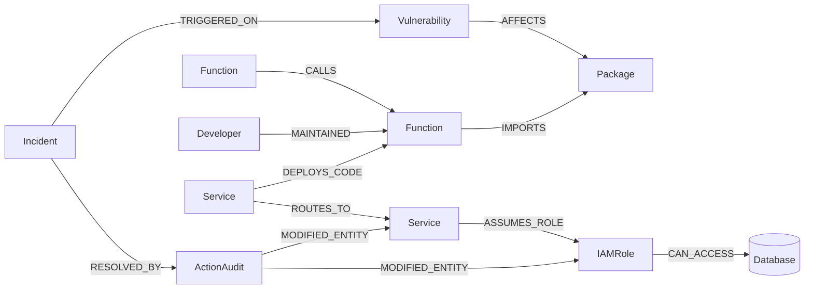
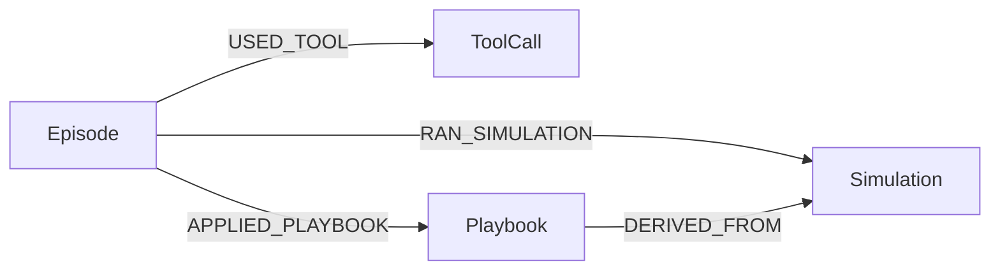

# Graph data model

AegisGraph keeps all of its context in FalkorDB, split across three kinds of graph in one instance:

| Graph | Purpose | Lifetime |
|---|---|---|
| `aegis_prod_graph` | The connected picture of production: code, packages, CVEs, services, IAM roles, databases, people, incidents and the audit trail of every action the agent took. | Persistent. Rebuilt by `python -m aegis seed`. |
| `aegis_memory_graph` | The agent's own memory: every run as an `Episode` with the ordered `ToolCall`s it made, every sandbox `Simulation`, and `Playbook`s learned from successful remediations. | Persistent across sessions, processes and agent modes. |
| `aegis_sim_<incident>_<id>` | A counterfactual sandbox, one per simulation: a `GRAPH.COPY` of production in which the proposed remediation is applied and verified before anything real changes. | Created per simulation. Kept for inspection when `AEGIS_KEEP_SANDBOX=true`. |

The prefix `aegis_` comes from `AEGIS_GRAPH_PREFIX` (the tests use `test_aegis_`).

## Production graph



The model joins three layers that normally live in separate tools:

- **Code:** `Vulnerability -> Package <- Function <- Developer`, plus the call graph `Function -CALLS-> Function`.
- **Runtime:** `Service -DEPLOYS_CODE-> Function` and the service mesh `Service -ROUTES_TO-> Service`.
- **Identity and data:** `Service -ASSUMES_ROLE-> IAMRole -CAN_ACCESS-> Database`.

The question "which customer data is exposed by this CVE?" is a path across all three layers, five to eight hops long. That is why the data lives in a graph rather than in tables or vector chunks.

### Node labels

| Label | Properties | Indexes | Role in the agent's reasoning |
|---|---|---|---|
| `Vulnerability` | `id`, `severity`, `cvss`, `summary`, `published`, `embedding` | range `id`, vector `embedding`, full-text `summary` | Entry point. An alert is anchored here by vector and full-text search. |
| `Package` | `name`, `version`, `fixed_version`, `ecosystem` | range `name` | What the CVE affects and which version fixes it. |
| `Function` | `id`, `name`, `file_path`, `repo_name`, `embedding` | range `id`, vector `embedding` | Code-level entity. The call graph shows transitive callers. |
| `Service` | `id`, `name`, `tier`, `status`, `rps` | range `id`, range `name` | Deployed microservice. `tier: critical` services are never isolated. |
| `IAMRole` | `arn`, `name`, `privilege_level`, `status` | range `name` | Cloud identity a service assumes. A quarantine target. |
| `Database` | `id`, `name`, `contains_pii`, `classification` | range `name` | Crown-jewel data. Exposure is measured against `contains_pii: true`. |
| `Developer` | `id`, `name`, `handle`, `team`, `on_call` | range `handle` | Code owner who receives the remediation pull request. |
| `Incident` | `id`, `timestamp`, `title`, `raw_alert`, `status` | range `id` | The event being triaged. Status moves `OPEN -> MITIGATED` (and back on rollback). |
| `ActionAudit` | `id`, `timestamp`, `action_type`, `target_entity`, `cve_id`, `exposure_after`, `bridge_service`, `iam_role`, `betweenness_score`, `pagerank_score`, `sim_passed`, `simulation_id`, `cypher_proof`, `proof_paths`, `mutations`, `assigned_developer`, `pr_url`, `justification`, `rolled_back`, `mode` | range `id` | Immutable explanation of one action: the scores, the paths that justified it, every mutation (for rollback) and the exact Cypher executed. |

`cypher_proof`, `proof_paths` and `mutations` are JSON strings, because FalkorDB properties cannot hold nested maps.

### Relationship types

| Pattern | Properties | Meaning |
|---|---|---|
| `(Vulnerability)-[:AFFECTS]->(Package)` | `exploitability` | The CVE applies to this package version. |
| `(Function)-[:IMPORTS]->(Package)` | `line_number` | The function uses the package directly. |
| `(Function)-[:CALLS]->(Function)` | `call_frequency` | Call graph for transitive reachability. |
| `(Developer)-[:MAINTAINED]->(Function)` | `commits_count`, `last_touched` | Ownership and expertise for routing the fix. |
| `(Service)-[:DEPLOYS_CODE]->(Function)` | `commit_sha` | Bridges code to runtime. |
| `(Service)-[:ROUTES_TO]->(Service)` | `status`, `is_critical_path`, `protocol`, `held_by`, `previous_status` | Service mesh traffic. `status` is `ACTIVE` or `ISOLATED_BY_AEGIS`; `held_by` lists the audits currently isolating the route. |
| `(Service)-[:ASSUMES_ROLE]->(IAMRole)` | `scope` | Identity a running service holds. |
| `(IAMRole)-[:CAN_ACCESS]->(Database)` | `status`, `access_mode`, `held_by`, `previous_status` | Data access. `status` is `ACTIVE` or `QUARANTINED_BY_AEGIS`; `held_by` lists the audits currently quarantining it. |
| `(Incident)-[:TRIGGERED_ON]->(Vulnerability)` | `detected_at`, `confidence` | What the incident is about. |
| `(Incident)-[:RESOLVED_BY]->(ActionAudit)` | `execution_time_ms` | The action taken for the incident. |
| `(ActionAudit)-[:MODIFIED_ENTITY]->(IAMRole \| Service)` | `previous_state`, `new_state`, `entity_kind` | What the action changed. |

### Exposure: the definition every tool shares

An **exposure path** for a CVE is an active path

```
(origin:Service)-[:ROUTES_TO*0..3]->(pivot:Service)-[:ASSUMES_ROLE]->(:IAMRole)-[:CAN_ACCESS]->(:Database {contains_pii: true})
```

where `origin` deploys a function that imports a package affected by the CVE. Every relationship on the path must have `coalesce(status, 'ACTIVE') = 'ACTIVE'`. Remediation removes exposure by flipping edge `status` values, which is surgical and reversible. Nothing in production is deleted. Each flip records the audit in the element's `held_by` list, and rollback restores the previous status only when the last hold is released.

### Indexes

| Index | Statement |
|---|---|
| Range indexes (10) | `CREATE INDEX FOR (v:Vulnerability) ON (v.id)` and the same for `Package.name`, `Function.id`, `Service.id`, `Service.name`, `IAMRole.name`, `Database.name`, `Developer.handle`, `Incident.id`, `ActionAudit.id` |
| HNSW vector indexes (2) | `CREATE VECTOR INDEX FOR (v:Vulnerability) ON (v.embedding) OPTIONS {dimension: 384, similarityFunction: 'cosine', M: 16, efConstruction: 200}` and the same on `Function.embedding` |
| Full-text index (1) | `CREATE FULLTEXT INDEX FOR (v:Vulnerability) ON (v.summary)` |

Embeddings are produced locally by `backend/aegis/embeddings.py`, a deterministic 384-dimension hashing embedding. It keeps the demo free of API keys. Swapping in a real embedding model only means changing `embed()`.

## Memory graph



| Label | Properties | Memory type |
|---|---|---|
| `Episode` | `id`, `incident_id`, `cve_id`, `started_at`, `finished_at`, `mode`, `outcome`, `summary`, `tool_call_count` | Episodic: one agent run. |
| `ToolCall` | `id`, `seq`, `name`, `args_json`, `result_digest`, `duration_ms`, `is_error`, `ts` | Episodic: what the agent did, in order. |
| `Simulation` | `id`, `incident_id`, `cve_id`, `timestamp`, `bridge_service`, `iam_role`, `safe`, `exposure_closed`, `critical_flows_intact`, `critical_services_connected`, `sandbox_graph`, `exposure_before`, `exposure_after` | Procedural evidence. It also gates `execute_remediation`. |
| `Playbook` | `signature` (for example `package:jwt-crypto-core`), `action_type`, `bridge_service`, `iam_role`, `success_count`, `last_used`, `last_incident_id` | Procedural: a remediation that worked, reusable for the next incident on the same package. |

Indexes: range on `Episode.id`, `Episode.incident_id`, `Simulation.id`, `Simulation.incident_id`, `Playbook.signature` and `ToolCall.id`.

The memory graph is shared by everything that runs the agent: the CLI, the API, deterministic mode and LLM mode. A run started from the console recalls the playbook that an earlier command-line run learned.

## Sandbox graph

`simulate_remediation` runs `GRAPH.COPY aegis_prod_graph aegis_sim_<incident>_<id>`, which copies nodes, edges and indexes. In the copy it:

1. deletes edges that are already inactive, so algorithms see the live topology;
2. deletes every `ROUTES_TO` edge touching the proposed bridge service and every `CAN_ACCESS` edge of the proposed IAM role;
3. recounts exposure paths, checks the four critical customer flows with variable-length path matching, and runs `algo.WCC` to confirm every critical-tier service is still in one component.

Deleting edges is how the sandbox models severing them, because the graph algorithms cannot filter edges by property. Production only ever receives status flags.

## Seeded demo dataset

`backend/aegis/seed.py` creates a synthetic, deterministic dataset in line with the hackathon's data policy.

| Label | Count | Examples |
|---|---|---|
| Service | 10 | `api-edge-gateway`, `auth-token-service`, `checkout-gateway`, `payment-orchestrator`, `inventory-service` (critical); `legacy-billing-bridge`, `reporting-adapter`, `telemetry-audit-sync`, `notification-service`, `search-indexer` (standard) |
| Function | 12 | `verify_bearer_token()`, `validate_checkout_session()`, `settle_merchant_payout()` |
| Package | 6 | `jwt-crypto-core 2.4.1` (fixed in 2.4.2), `legacy-sql-adapter`, `yaml-loader` |
| Vulnerability | 4 | `CVE-2026-8841` (critical, jwt-crypto-core), `CVE-2026-4102`, `CVE-2026-2210`, `CVE-2026-0193` |
| IAMRole | 4 | `LegacyBillingBridgeAdmin` (ADMIN), `PaymentReadWriteRole`, `ReportingReadOnly`, `InventoryWriter` |
| Database | 5 | `customer-kyc-vault-db`, `global-settlement-ledger`, `reporting-warehouse` (PII); `prometheus-archive-store`, `product-catalog-db` |
| Developer | 5 | `@aarav-sec` (on call), `@priya-payments`, `@rohan-platform` |
| Incident | 2 | `INC-2026-091` (open, the demo), `INC-2026-077` (mitigated history) |
| ActionAudit | 1 | `AUDIT-SEED-077`, the audit of the historical incident |

That is 49 nodes and 69 relationships. These facts about `CVE-2026-8841` are asserted by the test suite:

- The only origin service is `auth-token-service`, which deploys both functions that import `jwt-crypto-core`.
- There are 6 exposure paths to 3 PII databases, and every one of them passes through `legacy-billing-bridge`.
- `legacy-billing-bridge` has the highest betweenness of all services (6.0). The runner-up, `payment-orchestrator` (5.83), is critical-tier and is protected.
- The sandbox proves isolating `legacy-billing-bridge` and quarantining `LegacyBillingBridgeAdmin` takes exposure from 6 to 0. All four critical flows stay intact, and the bridge becomes its own component.
- After execution live exposure is 0. After rollback it is 6 again.
- The pull request goes to `@aarav-sec`, the on-call maintainer of `verify_bearer_token()`.
